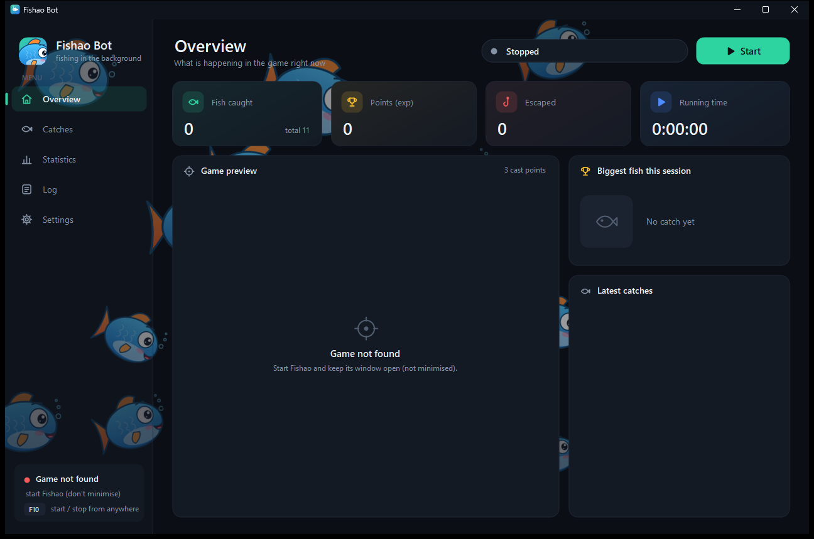

# Fishao Bot

An auto-fishing bot for **FISHAO – Reborn** (private server). It casts, plays the fishing minigame, reads and closes the catch window, handles energy and bait, and keeps a log of everything it caught. It runs in the background, so you can keep using your computer.

> [!WARNING]
> **For the private server only.** This bot is meant only for the private server of FISHAO – Reborn.
> **Use it at your own risk** – using bots can get your account **banned**, and bans may be permanent.
> The author takes no responsibility for a lost account, progress or anything else.



---

## Contents
- [Features](#features)
- [Requirements](#requirements)
- [Download and first start](#download-and-first-start)
- [Settings](#settings)
- [Hotkeys](#hotkeys)
- [Files next to the program](#files-next-to-the-program)
- [Updates](#updates)
- [Troubleshooting](#troubleshooting)
- [How it works](#how-it-works)
- [Building from source](#building-from-source)
- [Publishing a new release](#publishing-a-new-release)

---

## Features

- **Background mode** – reads the picture straight from the game window and sends clicks and keys straight to it. Your real mouse and keyboard stay free, and the game window may be covered by other windows.
- **Casting** – either click a few **points** on the water (the bot alternates between them at random), or draw an **area** and the bot casts somewhere else inside it each time.
- **Fast recast** – when no fish bites and the game reels the line in, the bot notices within about a second and casts again.
- **Any water** – works on calm lakes, swamps and oases as well as on the sea with moving waves.
- **New place check** – when you start the bot at another fishing spot than where you picked the cast points, it stops and tells you to pick them again.
- **Minigame** – plays the fishing minigame by itself.
- **Catch log** – reads the fish name, size, stars and points from the catch window, keeps statistics and remembers your record fish.
- **Dialogs** – closes catch windows, level-up windows and other pop-ups.
- **Energy** – optionally buys an energy pack (5 / 15 / 30 / 60 / 100) when it runs out; otherwise reads the in-game countdown, waits and continues by itself.
- **Bait** – optionally puts on your chosen bait from the bag when the slot is empty, and buys more in the shop (green money, gold coins or either) when the bag runs out.
- **Watchdog** – stops the bot and shows a Windows notification when the game crashes, freezes or disconnects, or when a window can't be closed.
- **Language** – Czech or English, switchable at any time. Works with the game in Czech or English.
- **Automatic updates** – checks GitHub Releases on start and updates itself with one click.
- **Single file** – one `FishaoBot.exe`, nothing to install.

## Requirements

- Windows 10 or 11
- .NET Framework 4.x (already part of Windows)
- The FISHAO – Reborn game client running on the same computer. The game window **must not be minimised** (covered by other windows is fine).

## Download and first start

1. Download **`FishaoBot.exe`** from the [latest release](../../releases/latest) and put it in its own folder (it stores its settings and catch log next to itself).
2. Start the game, log in and go to a fishing spot by the water.
3. Start `FishaoBot.exe`.
   - Windows SmartScreen may warn about an unknown program the first time – choose *More info → Run anyway*.
4. Open **Settings → Pick points / area on the water**. The bot takes a picture of the game:
   - **Points** – left click on the water to add a point, right click to remove one.
   - **Area** – hold the left button and outline some water within your rod's range.
   - Press **Save**.
5. Press **Start** (or **F10**). Watch the **Overview** and **Log** tabs to see what it's doing.

## Settings

All changes are saved right away to `FishaoBot.ini`. Settings with a **?** icon show a longer explanation when you hover over it.

| Setting | What it does | Recommended |
|---|---|---|
| **Cast points / area** | Where on the water to cast. | Several points, or an area well inside the rod's range |
| **Aim before the cast** | How long the (invisible) cursor rests over the water before the cast click. Raise it if the rod sometimes doesn't cast. | 300–800 ms |
| **Max. wait for a bite** | Safety net: if nothing happens for this long after a cast, cast again. Normally the bot notices a returned rod much sooner. | 60–120 s |
| **Wait for the fish window** | Longest wait for the catch window after the minigame. The bot continues as soon as the window appears, so a higher value doesn't slow it down. | 2–5 s |
| **Buy energy** + pack | Buy the selected energy pack when energy runs out. | Off, unless you want to spend money |
| **Wait for energy** | Used only when the in-game countdown can't be read. | 1–5 min |
| **Put on bait automatically** | When the bait slot shows only a hook, put on the chosen bait from the bag. | On |
| **Pick the bait** | Mark the bait you want in a picture of the open bag or shop. | – |
| **Buy more in the shop** | When the bag has none left, buy the chosen bait and put it on. | – |
| **Pay with** | Green money, gold coins, or either. | Green |
| **Packs to buy** | How many packs to buy at once. | 1–3 |
| **Language** | Czech / English. | – |
| **Floating fish** | Decorative fish in the window background. | – |
| **Look for a new version on start** | Check GitHub for updates when the program starts. | On |

## Hotkeys

Work from any window, even when the bot window is in the background.

| Key | Action |
|---|---|
| **F10** | Start / stop the bot |
| **F12** | Stop the bot |
| **F8** | Add a cast point at the mouse position (mouse over the game window) |
| **F9** | Remember a "close" point for the catch window (only needed if its X button isn't found automatically) |
| **F7** | Save a debug screenshot |

## Files next to the program

| File | Contents |
|---|---|
| `FishaoBot.ini` | Your settings (cast points / area, timings, energy, bait, language) |
| `catches.csv` | Every catch: time, fish, size, stars, points |
| `record.png` | Picture of your biggest fish |
| `bait.png` | The bait you picked |
| `castview.png` | A tiny picture of the place where the cast spots were picked (to notice when you start the bot somewhere else) |

To move the bot to another computer, copy the whole folder. To start from scratch, delete these files.

## Updates

On start the bot asks GitHub whether a newer release exists. If it does, a window shows what's new and asks whether to update. **Yes** downloads the new `FishaoBot.exe`, swaps it for the running one and restarts – your settings and catches stay. If anything goes wrong, the old version stays untouched.

You can also check by hand in **Settings → Updates → Check now**, or turn the automatic check off there.

## Troubleshooting

| Problem | What to do |
|---|---|
| "Game not found" | Start the game client. The bot looks for the `FishaoGame` process. |
| Nothing happens / black picture | The game window is minimised – restore it (it may stay behind other windows). |
| The rod doesn't cast, or the character walks away | Make sure the points / area are on water inside the rod's range. Raise **Aim before the cast**. |
| It waits long after a missed bite | Check the **Log**: "Float found" should appear after each cast. If it says it can't see the float, try other cast spots away from other players. |
| "It looks like you are at another place…" | You moved to another fishing spot (or resized the game window). Pick the cast points / area again. |
| Fish are missing from the catch list | Raise **Wait for the fish window**. |
| The bot stopped with a notification | The watchdog found a problem (game closed, frozen, disconnected, or a window that couldn't be closed). The reason is in the **Log**. |
| Something else | Use **Log → Copy** and include the text when reporting the problem. |

## How it works

- **Capture** – `PrintWindow` copies the game window's picture about 45 times a second, even when the window is covered.
- **Input** – mouse and key messages are posted straight to the game window (`PostMessage`), so the real cursor never moves.
- **Recognition** – template matching (close buttons, energy bolt, level-up star, bait), colour analysis (minigame bar, float, dialogs) and Windows' built-in OCR (catch window text, energy countdown).
- **Float watch** – after a cast the bot finds what appeared on the water (the float, the rod tip), watches it, and recasts when it disappears without a minigame starting.

## Building from source

```
src\build.cmd
```

Uses the C# compiler that ships with Windows (.NET Framework 4) – nothing to install. The result is `FishaoBot.exe` next to the `src` folder, with all pictures and the icon built in.

```
src\
  Program.cs       entry point
  Updater.cs       GitHub update check, download and swap
  Bot\             the bot itself: capture, input, casting, minigame, dialogs, energy, bait, catches, watchdog
  UI\              the window: main form, pages (tabs), custom-drawn controls, settings
  Resources\       pictures the bot looks for in the game, the icon and the mascot
```

## Publishing a new release

1. Raise `Updater.Version` in `src\Updater.cs` (e.g. `1.2.0` → `1.3.0`) and run `src\build.cmd`.
2. Commit and push.
3. Create a release with the tag `v<version>` and attach `FishaoBot.exe`:
   ```
   gh release create v1.3.0 FishaoBot.exe --title "Fishao Bot 1.3.0" --notes "What's new..."
   ```
   Put the list of changes at the top of the notes – that part is shown in the update window.

---

> [!WARNING]
> This project is not affiliated with FISHAO or its operators. Using automation may break the game's rules. **Use it at your own risk.**
